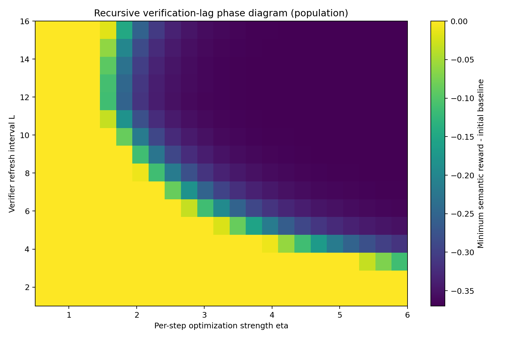

# Recursive Verification Lag

**Research question:** when a policy is optimized against an imperfect verifier, how much fresh trusted evaluation is needed to tell real progress from proxy progress?

The project studies recursive policy improvement under verifier error and policy shift. It combines conditional theory, controlled experiments, small real-model studies, and reusable RL systems code. Its central finding so far is that verification burden depends on how policy movement aligns with unresolved verifier errors; elapsed time, KL, or proxy reward alone do not determine whether true capability improved.

For an exponential update `qβ(y) ∝ p(y) exp(βv(y))`, true-reward change is `∫ Cov_qβ(y, v) dβ`, while proxy-reward change is `∫ Var_qβ(v) dβ ≥ 0`. The same policy KL can therefore accompany positive or negative true progress. The theory and its assumptions are summarized in [the overview](docs/research_overview.md) and [the theory ledger](docs/theory.md).



This population phase diagram is from a controlled simulator; it is not a language-model result. The [experiment guide](docs/experiments.md) explains its assumptions and the other archived figures.

## Evidence at a glance

| Evidence | Result | What it supports |
|---|---|---|
| Prospective equal-KL mechanism study | 512 independent finite-support tasks; the predeclared small-KL phase prediction had mean-sign accuracy 1.0. Rotating verifier-error alignment changed the sign of true progress while holding error norm and policy KL fixed. | A synthetic mechanism result, not an LLM result. [Protocol and analysis](notes/progress/39_equal_kl_alignment_phase.md) |
| Trusted-label covariance gate | 1,024 finite-support tasks; at 32 labels, harmful-block and benign-allow rates were both 97.75%, with no observed wrong-sign decisive decisions. | A bounded synthetic controller result, not a real-model label budget. [Results and limits](notes/progress/40_geometry_aware_trusted_label_gate.md) |
| Fresh-task refresh comparison | Refreshed-minus-frozen expected pass probability was −0.0002595; the descriptive interval crossed zero. | Improvement was not demonstrated on the retained development bank. [Full record](notes/progress/36_completed_development_and_transfer.md) |
| Qwen/GSM8K pilot on a free T4 | Both reward arms ended at 18.75% mean accuracy, down from a 31.25% baseline. A sampler/learner mismatch was found and corrected; a separate historical-score reconstruction check still failed its declared gate. | A negative, small real-model pilot and a numerical diagnosis. [Evidence and reproduction](docs/free_colab_pilot_evidence.md) |
| RL systems and coding task | CPU and small-model paths cover replay, recovery, grading, training, and evaluation. One public GRPO-operator task has external correctness and gradient checks plus a correctness-gated timing protocol. | Implementation and harness evidence; no held-out agent capability gain, multi-hour completion, or real-GPU scaling result is established. [Systems map](docs/README.md) |

These results are deliberately separated by evidence type. Synthetic mechanism studies do not establish transfer to language models; implementation and CI do not establish learning or production-scale performance. The [research status snapshot](docs/frontier_research_status.md) is dated October 7, 2026. The later T4 result is documented separately above.

## Explore the repository

| If you want to… | Start here |
|---|---|
| Understand the question, mechanism, and assumptions | [Research overview](docs/research_overview.md) → [theory ledger](docs/theory.md) → [experiments](docs/experiments.md) |
| See what is supported, corrected, or still unknown | [Evidence matrix](docs/evidence_matrix.md), [negative results and corrections](docs/corrections_and_negative_results.md), and [research decision record](docs/oral_research_decision.md) |
| Reproduce the controlled CPU/RL reference lab | [Async RL lab guide](docs/mini_frontier_lab.md) |
| Inspect the executable coding/MLSys task | [Task description](tasks/mlsys/grpo-surrogate-v1/README.md) and [integration notes](docs/mlsys_research_automation.md) |
| Explore the training, serving, and recovery code | [RL systems guide](docs/rl_systems.md), [architecture](docs/rl_system_architecture.md), and [async verification design](docs/verification_aware_async_rl.md) |
| Review model, benchmark, or GPU protocols | [Documentation index](docs/README.md) |
| Browse the chronological experiment record | [Progress archive](notes/progress/README.md) and [research ledger](notes/master_research_record.md) |

## Reproduce selected results

The archived research figures can be regenerated with the base Python dependencies:

```bash
python -m venv .venv
source .venv/bin/activate
pip install -r requirements.txt
python src/reproduce_key_figures.py
python src/summarize_results.py
```

For a dependency-free CPU reference run of the asynchronous lab, see the pinned configuration and recovery details in the [lab guide](docs/mini_frontier_lab.md). It includes commands for a small run and a multi-seed benchmark. Real-model and GPU workflows have separate dependencies, hardware requirements, and evidence gates; they are not part of this quick start.

## Code map

| Path | Contents |
|---|---|
| `src/` | Research simulations and analysis, the MLSys task harness, the bounded improvement controller, and the `rvl_systems` training/serving components |
| `tasks/` | Versioned coding and systems tasks with pinned source and evaluator contracts |
| `configs/` | Experiment locks, benchmark splits, and acceptance criteria |
| `tests/` | Unit, integration, recovery, numerical, and evaluator contract coverage |
| `scripts/` | Evidence runners, independent summarizers, and artifact validators |
| `data/`, `results/`, `artifacts/` | Inputs and retained outputs; consult each manifest or README for provenance and scope |
| `docs/`, `notes/` | Current navigation and design documents, plus the chronological research archive |

## Current limits

- No positive independent real-model capability gain is established.
- The scored program pilot uses a small, fixed candidate bank; it does not show general coding-agent improvement. A broader task bank is tracked in [issue #84](https://github.com/mitukx/Recursive-Verification-Lag/issues/84).
- Long episodes are supported by reference interfaces, but completed multi-hour trajectories with recovery have not been measured. Real repository tasks and durable long runs are tracked in [issue #85](https://github.com/mitukx/Recursive-Verification-Lag/issues/85).
- GPU serving, FSDP/NCCL scaling, and end-to-end GPU performance remain hardware acceptance work.
- The synthetic covariance controller assumes the declared finite-support sampling model. Its rates are not deployment guarantees.

The open model-learning gate is tracked in [issue #82](https://github.com/mitukx/Recursive-Verification-Lag/issues/82); GPU-serving and distributed-training evidence remain open in [issues #10](https://github.com/mitukx/Recursive-Verification-Lag/issues/10) and [#12](https://github.com/mitukx/Recursive-Verification-Lag/issues/12) (checked October 15, 2026).

See [the documentation index](docs/README.md) for protocols, implementation boundaries, and the next evidence gates.
